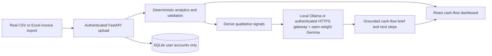

# CashFlowLens — your privacy-first AI cash-flow copilot

**Turn invoice totals into grounded next steps with local or securely hosted Gemma.**

CashFlowLens is a privacy-first cash-flow copilot for freelancers and small agencies. Upload a CSV or Excel invoice export: deterministic analytics calculate receivables and due-date-based inflows, then an open-weight Gemma model turns privacy-filtered aggregates into a concise cash-flow brief and practical follow-ups. AI interpretation is the product's core workflow; the model does not calculate or change financial totals.

The API reduces verified totals and payment history to qualitative state signals before sending them to Ollama; exact amounts, counts, client names, invoice identifiers, contact details, dates, and raw invoice rows are excluded from the prompt. Gemma selects only from server-allowlisted focus and action IDs, and the server renders the final brief from fixed text rather than trusting free-form model claims. Local Ollama remains the default. A remote HTTPS Ollama-compatible gateway is allowed only when the backend is explicitly configured for production and has a backend-only API key. Invoice uploads are analyzed in request memory and are not persisted by the API.

## How it works



Gemma contributes the interpretation and next-step brief after every successful upload; it is not a decorative chatbot. Deterministic calculations remain the financial source of truth. The API derives qualitative signals server-side and sends only those signals to the configured Ollama service. In remote mode, the backend sends `Authorization: Bearer <OLLAMA_API_KEY>` directly to the HTTPS gateway; the frontend never receives the key.

> **MVP/security note:** This is a development prototype, not production-ready financial software. Authentication uses a custom signed bearer token and PBKDF2 password hashes. Set a strong `CASHFLOWLENS_TOKEN_SECRET`, use HTTPS, add rate limiting, CSRF-safe deployment architecture, account recovery, and security review before public launch. Do not upload real financial data to a public deployment until its data handling has been reviewed.

## What works now

- Account registration and login with SQLite-backed user accounts
- Password hashing with PBKDF2-HMAC-SHA256 and expiring signed bearer tokens
- Authenticated CSV / XLSX / XLS upload (8 MB limit)
- Server-side schema validation and deterministic invoice analytics
- Dynamic dashboard based on the uploaded file, not hardcoded sample metrics
- Automatic Gemma cash-flow brief after each successful invoice upload, using local or explicitly configured production inference
- Qualitative prompt allowlist: exact amounts, client names, and invoice-level data never reach the model; structured model choices are allowlisted and rendered as vetted copy
- Clear model loading, retry, and unavailable states; deterministic accounting stays visible if Ollama is offline
- Expected inflows by due date for the next 30 days
- Client payment-delay summaries based on paid invoices with a paid date
- Optional experimental payment-risk estimates for unpaid invoices, based on labeled history in the uploaded file
- Follow-up email drafts for unpaid invoices
- Gemma explanation endpoint, using qualitative signals rather than raw invoice rows; local mode is loopback-only and remote mode requires production HTTPS plus a backend API key
- Invoice file content is analyzed in request memory and is not saved by the API; user accounts are stored in SQLite

## Run locally

Use two terminals.

### 1. Backend (Python 3.11+ recommended)

```bash
cd backend
python -m venv .venv
# Windows PowerShell:
.venv\\Scripts\\Activate.ps1
# macOS/Linux:
# source .venv/bin/activate
pip install -r requirements.txt
copy .env.example .env  # Windows; on macOS/Linux use: cp .env.example .env
uvicorn app.main:app --reload --port 8000
```

Change `CASHFLOWLENS_TOKEN_SECRET` in `backend/.env` to a long random value before exposing the service. The SQLite database is created automatically at `backend/cashflowlens.sqlite3` by default.

### 2. Frontend

```bash
cd frontend
npm install
npm run dev
```

Open the Vite URL (normally `http://localhost:5173`). Optionally set `VITE_API_URL` in `frontend/.env` if the API is not at `http://localhost:8000`.

### 3. Local Gemma (required for the AI cash-flow brief)

Install and start [Ollama](https://ollama.com/) on the same machine as the API, then download the default open-weight model:

```bash
ollama pull gemma3:4b
```

Ollama's default address is `http://127.0.0.1:11434`; the API uses `gemma3:4b` unless configured otherwise. To customize, set `OLLAMA_BASE_URL` and `OLLAMA_MODEL` in `backend/.env` before starting the API. The AI brief runs automatically after each successful invoice upload and can be regenerated from the dashboard. If Ollama is unavailable, the UI reports the error and keeps the deterministic financial calculations available.

The local model is not bundled with this repository and must be downloaded before a complete local demo. For a live demonstration, start Ollama and the API on the demo machine, upload the supplied sample CSV, and show the real generated brief alongside the deterministic figures. Do not present a mocked or prewritten AI response as live model output.

### Hosted Ollama-compatible gateway (production only)

Set these variables in the backend's production secret manager; keep the key out of source control and every frontend variable:

```text
CASHFLOWLENS_ENV=production
OLLAMA_BASE_URL=https://your-ollama-gateway.example.com
OLLAMA_MODEL=gemma3:4b
OLLAMA_API_KEY=<provider-issued-secret>
```

`OLLAMA_BASE_URL` is a gateway base URL; the API appends `/api/generate`. Use a gateway that supports Ollama's generate API and JSON-schema `format` option. The backend sends the key only in its outbound `Authorization: Bearer ...` header. Remote mode is rejected unless production is explicitly enabled, the URL uses HTTPS, and a valid key is set; local mode remains the default (`http://127.0.0.1:11434`) and ignores any configured key. Do not expose Ollama port 11434 publicly—keep Ollama bound to a private interface behind a secured HTTPS gateway or reverse proxy.

No production gateway URL or credential has been supplied, so remote inference has not been tested against a live provider. Validate the actual gateway URL, TLS, authentication, model availability, and structured-output support before relying on it. If inference is unavailable, deterministic invoice analytics remain available.

## File format

Required columns (case-insensitive; spaces in headers are converted to underscores):

- `client`
- `invoice_date`
- `due_date`
- `amount`
- `status`

Optional: `invoice_id`, `paid_date`. Some common aliases such as `client_name`, `customer`, `invoice_number`, `total`, `invoice_amount`, `payment_status`, `paid_on`, and `payment_date` are recognized. ISO dates (`YYYY-MM-DD`) are recommended. Statuses `paid`, `complete`, or `completed` are treated as paid; a valid `paid_date` also marks an invoice as paid.

A sample file is available at `sample-data/invoices.csv` and through the app's upload empty state. For the live demo, `backend/sample-data/demo_invoices.csv` is generated with dates relative to today and includes historical paid invoices plus overdue and upcoming unpaid invoices; regenerate it with `python backend/scripts/make_demo_invoices.py`.

## API overview

- `GET /health` — health check
- `POST /api/auth/register` — create an account
- `POST /api/auth/login` — authenticate
- `GET /api/auth/me` — current user (Bearer token)
- `POST /api/analytics/upload` — authenticated CSV/XLSX analysis (multipart field `file`)
- `POST /api/payment-risk/upload` — authenticated experimental payment-risk estimates and holdout benchmark (multipart field `file`)
- `POST /api/explain` — authenticated Ollama/Gemma brief from allowlisted aggregate metrics

Interactive API docs: `http://localhost:8000/docs`.

## Analytics caveats

- Expected inflows are the sum of unpaid invoices with due dates within the next 30 days, not a probability-weighted forecast.
- Payment-delay summaries are descriptive and use only paid invoices with valid `paid_date` values.
- The separate experimental payment-risk scores are uncalibrated model outputs, require sufficient labeled payment history, and are not probabilities or guarantees of payment.
- Small samples can be misleading. This MVP does not provide financial, accounting, or tax advice.

## Challenge demo checklist

- Run a locally installed Gemma model through Ollama; do not use the `gemma4:cloud` model when demonstrating local inference.
- Upload a real invoice export or the included sample CSV; distinguish sample data from real client data in the demo.
- Show that deterministic totals are calculated before Gemma's generated interpretation.
- Explain the privacy boundary: show that the server reduces analytics to qualitative flags before making the local request, and that the model selects only allowlisted focus/action IDs; do not stage or label a canned response as live output.
- Include the public source repository, a working demo link, why open-weight/local inference matters for freelancer invoice privacy, and first-user feedback if available in the DEV submission.

## Next steps

- Add tests for auth, file parsing, analytics, and malformed spreadsheets
- Add column mapping and more export-specific header aliases
- Add robust rate limiting, secure session management, and account recovery before public deployment
- Validate experimental payment-risk estimates on representative historical data
- Gather real first-user feedback with consent

## License

MIT. See [LICENSE](LICENSE).
